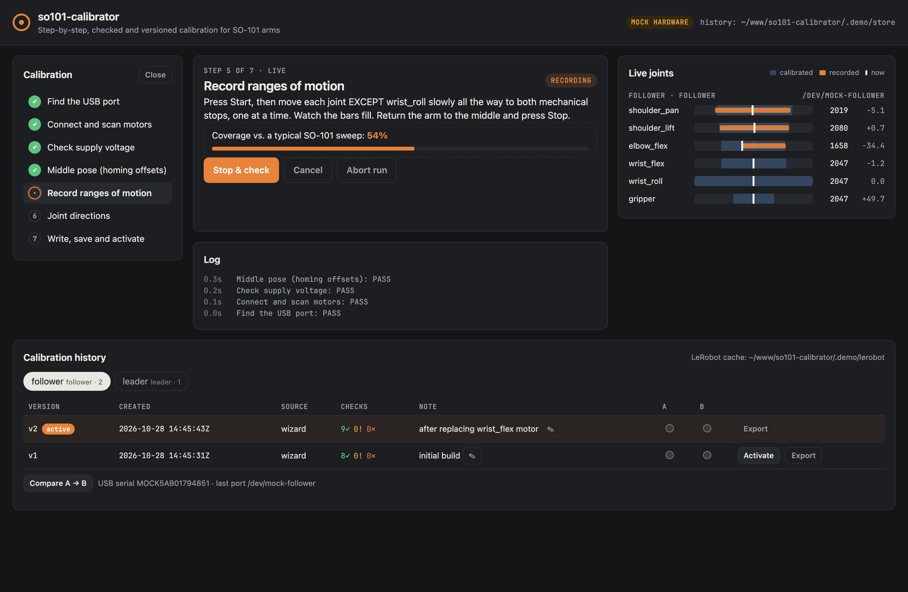

# so101-calibrator

Step-by-step, **checked** and **versioned** calibration for the SO-101 leader and follower arms,
compatible with [LeRobot](https://github.com/huggingface/lerobot). One core, two front ends: a CLI
wizard and a local web dashboard.



`lerobot-calibrate` does the math right but asks you to do everything blind: press ENTER, move the
arm, hope. When something is off (a motor on the wrong id, the follower running on USB power, a
joint swept only halfway, a motor mounted backwards) you find out later, as a jerky teleop session or a
policy that never learns. This tool runs the same calibration as a sequence of steps, checks every
step, tells you what to do when a check fails, and keeps every calibration as a version you can
diff, roll back and export.

## Features

- **Wizard with a pass / warn / fail check on every step**, and a concrete fix for every failure:

  | Step | What is checked |
  | --- | --- |
  | Find the USB port | Detected by unplugging the cable (port diff); USB serial number recorded |
  | Motors | Ids 1–6 answer at 1 Mbps; missing ids name the cable to check; unconfigured motors found at other baud rates |
  | Supply | Follower ~12 V (or 7.4 V preset), leader ~5 V and **never 12 V**; voltage drop along the chain; motor temperature |
  | Middle pose | Homing offsets written and read back as 2047; offset near the ±2047 limit; drift vs. the previous calibration |
  | Ranges | Range too narrow, middle pose outside the range or off-centre, encoder wrap (0/4095), span change vs. last time |
  | Directions | Which way each encoder counts, compared with the paired arm and with the previous calibration (catches a reversed motor / flipped horn) |
  | Save | Valid LeRobot format, written to the motors and read back, stored as a new version, exported |

- **Verify** an existing calibration: motor EEPROM still matches the active version, and the arm put
  back in the middle pose reads ~2047 on every joint.
- **Teleop test**: refuses to start if leader and follower poses differ (the follower would jump),
  then mirrors leader → follower with a rate limit and measures per-joint tracking error.
- **History**: every calibration stored with timestamp, role, USB serial, port, note and the check
  results. List, show, diff two versions, roll back, export to the LeRobot cache or any `calibration_dir`,
  import existing LeRobot files.
- **Dashboard**: the same wizard in the browser, with live joint bars (calibrated range, range recorded
  so far, current position) and the history with diff and one-click rollback.
- **Mock hardware**: a simulated leader + follower (register-level STS3215 emulation and a "hand" that
  moves the arm) with fault injection. Every test runs on it; you can try the whole tool without an arm.
- Pure standard library core. The only hardware dependencies are Feetech's `scservo_sdk` and `pyserial`.

## Install

Requires Python ≥ 3.10. With [uv](https://docs.astral.sh/uv/):

```bash
git clone https://github.com/fport/so101-calibrator && cd so101-calibrator
uv sync --extra hardware          # drop --extra hardware to only try the mock
uv run so101-cal --help
```

or as a global tool: `uv tool install "so101-calibrator[hardware] @ git+https://github.com/fport/so101-calibrator"`.

## Try it without hardware

```bash
uv run so101-cal --mock dashboard                     # opens http://127.0.0.1:8101
uv run so101-cal --mock calibrate follower            # the CLI wizard against the simulated arm
uv run so101-cal --mock --mock-faults reversed:elbow_flex,voltage:5 calibrate follower
```

Faults: `missing:<id>`, `voltage:<V>`, `reversed:<joint>`, `stuck:<joint>`, `hot:<joint>`; prefix with
`leader.` to target the leader.

## Calibrating a real arm

Do the follower and the leader separately. The `--id` is the LeRobot id you will later pass as
`--robot.id` / `--teleop.id` (default: `follower` / `leader`).

```bash
uv run so101-cal calibrate follower --id follower --note "first calibration"
uv run so101-cal calibrate leader --id leader
uv run so101-cal teleop-test                          # short leader -> follower check
```

The wizard walks you through:

1. **Port**: with only this arm's board plugged in, press ENTER, unplug its USB cable, plug it back
   in. The port is remembered for next time (pass `--port` to skip this).
2. **Motors** and 3. **Supply**: the follower needs its 12 V adapter plugged in (`--supply 7.4v` for
   kits with 7.4 V motors). The leader runs on 5 V.
4. **Middle pose**: torque is off; put every joint in the middle of its range (upper arm and forearm
   at a right angle, wrist straight, gripper half open) and press ENTER.
5. **Ranges**: press ENTER, move each joint except `wrist_roll` slowly to both mechanical stops, one
   at a time, return to the middle and press ENTER. The live bars show what has been recorded.
6. **Directions**: move the joint that is shown a little in the described direction; the step moves
   on by itself. Calibrate the second arm the same way and the two are compared.
7. **Save**: written to the motors, read back, stored and exported to where LeRobot reads it.

On a warning you can continue or retry; on a failure the fix is printed and you retry. A calibration
pushed past a failure (`f`) is stored for reference but **not** activated or exported.

LeRobot then picks the files up with no extra flags:

```bash
lerobot-teleoperate --robot.type=so101_follower --robot.port=/dev/tty.usbmodem... --robot.id=follower \
  --teleop.type=so101_leader --teleop.port=/dev/tty.usbmodem... --teleop.id=leader
```

If LeRobot asks *"Press ENTER to use provided calibration file … or type 'c'"*, press ENTER: the file
already matches the motors.

> **Safety:** the teleop test enables follower torque. Start with both arms in the same pose (the test
> refuses otherwise), keep the workspace clear, and keep a hand near the follower when the test ends:
> it goes limp again.

## History, diff, rollback

```bash
so101-cal history                     # all arms and versions
so101-cal show follower               # active version (or: show follower 3, --json)
so101-cal diff follower 2 3           # per joint/field deltas in ticks
so101-cal activate follower 2         # roll back: make v2 active and export it
so101-cal write follower              # also push the active version into the motors' EEPROM
so101-cal export follower --calibration-dir hardware/calibration   # for --robot.calibration_dir users
so101-cal import ~/.cache/huggingface/lerobot/calibration/robots/so_follower/follower.json \
  --role follower --id follower --note "made with lerobot-calibrate"
so101-cal verify follower             # still valid? (EEPROM + middle pose)
so101-cal where follower --id my_arm  # path LeRobot reads for this id
```

The store is plain JSON, by default in `~/.so101-calibrator` (`--store DIR` or `$SO101CAL_HOME` to
change it, e.g. to a folder in your project's git repo):

```
~/.so101-calibrator/
  follower/
    arm.json        role, USB serial, last port, active version
    v0001.json      metadata, check results, joint directions, LeRobot calibration
    v0002.json
  leader/ …
```

Export targets `$HF_LEROBOT_CALIBRATION`, else `$HF_LEROBOT_HOME/calibration`, else
`~/.cache/huggingface/lerobot/calibration`, under `robots/so_follower/<id>.json` and
`teleoperators/so_leader/<id>.json` as LeRobot ≥ 0.4 expects (`--legacy-export` for the older
`so101_follower` / `so101_leader` directories). A different file already at the target is kept as
`<name>.bak-<timestamp>`.

## How it relates to LeRobot

The calibration itself is identical to `lerobot-calibrate` for the SO-101: homing offset =
position − 2047 in the middle pose, recorded min/max for every joint, `wrist_roll` fixed to 0..4095,
`drive_mode` 0, and the same JSON format. The motor access is a small driver on Feetech's
`scservo_sdk` (the SDK LeRobot uses), so this tool does not need LeRobot or PyTorch installed.

Built against the LeRobot 0.6.1 file layout. SO-100 arms use the same motors and will probably work,
but are untested.

## Troubleshooting

| Symptom | Likely cause |
| --- | --- |
| No serial port disappears when unplugging | Charge-only USB cable, or the CH343 driver is missing (Windows) |
| "No motor answers" | Power adapter off / not plugged, or the cable to the first motor |
| Motors only answer at another baud rate | Motors were never set up: run `lerobot-setup-motors` once |
| "Missing motor id(s): 4" | Loose daisy-chain cable going into that motor |
| Direction mismatch on one joint | Motor or horn mounted the other way round on one arm |
| Verify: EEPROM differs | Motor replaced, or another tool wrote a different calibration: recalibrate or `so101-cal write` |

## Contributing

See [CONTRIBUTING.md](CONTRIBUTING.md). Reports from real arms that help tune the thresholds in
`profiles.py` are very welcome.

## License

[MIT](LICENSE)
